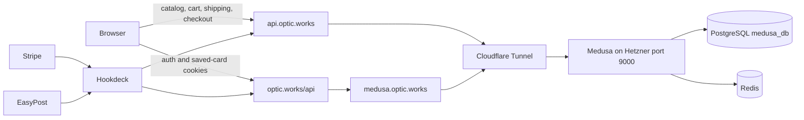

# Legacy backend API and frontend integration

This is the historical interface of the OpticWorks storefront and Medusa backend, preserved before the backend rebuild. It describes existing behavior, including incomplete and inconsistent paths; it is not a requirements document for the company's next product lines.

Reference date: 2026-10-29. Repository commit: `13b04849bb05dbedcbf142ddcfb42cd30165f7ec`. Installed backend: Medusa **2.12.0**. The backend was subsequently quiesced for snapshot preparation; public API URLs now deliberately return `503 BACKEND_OFFLINE`.

## Coverage and sources

- [Complete installed backend route index](legacy-api/backend-routes.json): **281 route files, 424 exported method/path operations**. This contains 272 Medusa route files and 9 application route files. Framework health handling and the admin SPA are recorded separately below.
- [Frontend API route index](legacy-api/frontend-routes.json): every Next.js `src/app/api/**/route.ts` handler in this reference commit, with methods and source locations.
- The tables below describe the Medusa operations actually referenced by the frontend, all custom backend routes, and the Next.js API layer.
- The index records routes found in installed package/source files; it is not a claim that every route was exercised or that every provider integration works. Body/response descriptions come from callers and custom handlers, not a regenerated complete Medusa OpenAPI schema.
- The installed package's built-in handlers are the version-specific source of truth. Current [Medusa Store API](https://docs.medusajs.com/api/store) and [Admin API](https://docs.medusajs.com/api/admin) docs can differ from 2.12.0.

## Network and authentication boundary

Before disconnection, both backend hostnames reached the same Medusa process through tunnel `opticworks-medusa`. `api.optic.works` is the browser URL; `medusa.optic.works` is the server-side URL used to work around earlier Cloudflare routing behavior. They are not separate backends. Local origin: `http://127.0.0.1:9000`.

| Setting or header | Existing contract |
| --- | --- |
| `NEXT_PUBLIC_MEDUSA_BASE_URL` | Browser backend base URL. Next.js public variables are compiled into browser code. |
| `MEDUSA_SSR_BASE_URL` | Preferred server-side base URL. Shared client selects this when `window` is absent. |
| `NEXT_PUBLIC_MEDUSA_ENABLED` | Enables catalog/cart integration in callers; changing a Worker variable alone does not rebuild browser code. |
| `NEXT_PUBLIC_MEDUSA_PUBLISHABLE_KEY` | Sent as `x-publishable-api-key`; public sales-channel credential, not customer/admin authentication. |
| `Authorization: Bearer <token>` | Customer bearer token for authenticated customer operations; admin routes use separate admin authentication. Never embed a real token in examples. |
| `Content-Type: application/json` | Shared client request format. The shared client expects a JSON response on successful requests. |
| `medusa_auth_token` | Frontend httpOnly cookie, Secure in production, SameSite=Lax, Path=/, seven-day cookie lifetime. Auth proxy endpoints bridge it to backend bearer auth. |
| `medusa_cart_id` | Browser-readable cart-ID cookie, Path=/, SameSite=Lax, seven-day lifetime, Secure in production. Used for SSR cart hydration. This is not proof of customer identity. |
| Local storage | `cart-storage` persists cart UI state/cart IDs; auth store persists minimal signed-in state, then fetches current customer. It does not persist the bearer token in the current auth flow. |
| `x-correlation-id` | Backend echoes incoming correlation/request ID or generates one; useful for matching logs. |

Primary implementations: [shared client](../../src/lib/api/medusa.ts), [SSR cart reader](../../src/lib/api/medusa-server.ts), [auth store](../../src/hooks/useAuth.ts), [cart store](../../src/hooks/useCart.ts), [cart cookies](../../src/lib/cart/cookies.ts), [middleware](../../backend/src/api/middlewares.ts).

Shared-client failures throw an error containing HTTP status and response text. Catalog methods catch failures and return static fallback products. Other operations generally surface an error. Do not copy the existing logging of headers, provider objects, payment data or raw error bodies into the replacement implementation.

## Medusa operations consumed by the storefront

All paths below are relative to the backend base URL. `:id` denotes a path parameter, not a literal string. Store requests use the publishable key; rows marked customer additionally use bearer authentication.

| Method and path | Input | Response used by frontend | Caller |
| --- | --- | --- | --- |
| GET `/store/products` | `fields=*variants.prices,+variants.inventory_quantity`; optional `handle` for detail lookup | `{products}` with variants, prices, inventory and metadata; transformed to frontend Product objects | `listProducts`, `getProductById` in `medusa.ts` |
| GET `/store/regions` | None | `{regions}`; default-region helper selects the US region or first region | `getRegions`, `getDefaultRegionId` |
| POST `/store/carts` | `{region_id}` | `{cart}` | `createCart`, `useCart.initializeCart` |
| GET `/store/carts/:cart_id` | Cart ID | `{cart}` including items/totals; SSR uses `cache: no-store` | `getCart`, `getCartSSR`, order polling |
| POST `/store/carts/:cart_id` | Optional `email`, `shipping_address`, `billing_address`, `customer_id`, `metadata` | `{cart}` | `updateCart`, checkout/shipping |
| POST `/store/carts/:cart_id/line-items` | `{variant_id, quantity}` | `{cart}` | `addLineItem` |
| POST `/store/carts/:cart_id/line-items/:line_item_id` | `{quantity}` | `{cart}` | `updateLineItem` |
| DELETE `/store/carts/:cart_id/line-items/:line_item_id` | IDs | Shared caller assumes `{cart}` | `removeLineItem`; verify the exact Medusa deletion envelope before copying this assumption |
| GET `/store/shipping-options` | `cart_id` query | `{shipping_options}` | `getShippingOptions`, `useMedusaShipping` |
| POST `/store/shipping-options/:option_id/calculate` | `{cart_id}` | `{shipping_option:{calculated_price}}`; uses `calculated_amount`, tax-inclusive flag | `calculateShippingOptionPrice` |
| POST `/store/carts/:cart_id/shipping-methods` | `{option_id}` | `{cart}` | `addShippingMethod`; hook refetches cart totals/tax |
| POST `/store/payment-collections` | `{cart_id}` | `{payment_collection}` | `createPaymentCollection`; helper may reuse an existing session |
| POST `/store/payment-collections/:collection_id/payment-sessions` | `{provider_id:"pp_stripe_stripe"}` | `{payment_collection:{payment_sessions}}`; selected session's `data.client_secret` goes to Stripe Elements | `createPaymentSession`, `createMedusaPaymentSession` |
| POST `/store/carts/:cart_id/complete` | No JSON body | Caller assumes `{type,order}` then returns `order.id`, `display_id` | `completeCart`; error/discriminated-union cases need explicit handling in a replacement |
| GET `/store/orders/:order_id` | Order ID | `{order}` with items, display ID, totals, email, status | `getOrder` helper; existence of a helper is not proof all UI paths invoke it |
| POST `/auth/customer/emailpass/register` | `{email,password}` | `{token}` | Auth registration proxy, first step |
| POST `/store/customers` | Customer auth; `{email,first_name?,last_name?,phone?}` | `{customer}` | Registration profile creation |
| POST `/auth/customer/emailpass` | `{email,password}` | `{token}` | Login proxy |
| GET `/store/customers/me` | Customer auth | `{customer}` | Login/register profile fetch and `/api/auth/me` |
| POST `/store/customers/me` | Customer auth; optional `first_name,last_name,phone` | `{customer}` | `updateCustomerProfile` helper |
| POST `/auth/token/refresh` | Customer auth | `{token}` | Refresh proxy |
| POST `/auth/customer/emailpass/reset-password` | `{identifier:email}` | Shared helper expects successful JSON; frontend hides downstream errors to avoid email enumeration | Forgot-password proxy |
| POST `/auth/customer/emailpass/update` | Reset-token bearer; `{email,password}` | Shared helper expects successful JSON | Reset-password proxy |
| GET `/store/customers/me/payment-methods` | Customer auth | `{payment_methods:[{id,provider_id,data}]}` | Saved-card Next.js proxy |
| DELETE `/store/customers/me/payment-methods` | Customer auth; `payment_method_id` query | `{success:true}` | Proxy translates browser `id` query to backend `payment_method_id` |

### Main catalog, cart and payment sequence

1. Catalog comes from Medusa products/variants, or the old static product list on failure. The public `getProductById` helper actually performs a **handle** query; its argument name is misleading.
2. `useCart` discovers a region, creates/loads the Medusa cart, and syncs its ID to cookie/local storage. Line-item requests use variant IDs, not the legacy product handles used by static mock APIs.
3. Checkout writes email and addresses, retrieves shipping options, calculates carrier prices for calculated options, selects shipping, then reloads authoritative Medusa totals. Existing code treats Medusa v2 amounts as major currency units and converts to cents for Stripe Elements. Retest money units rather than applying the same conversion to every external provider.
4. `CheckoutWrapper.tsx` mounts Stripe Elements in deferred-intent mode (`mode`, amount, currency), then `CheckoutForm.tsx` submits Elements, updates final cart details and creates a Medusa payment session at submit time. Provider ID is `pp_stripe_stripe`.
5. The session's Stripe client secret is used for `stripe.confirmPayment`. On `succeeded` or `requires_capture`, the UI calls cart completion and navigates using the returned order ID.
6. Completion failure enters cart polling: default ten attempts, three seconds apart, checking `completed_at` and optional `order_id/order`. The comment that a webhook will complete the order is an assumption, not proof. The Stripe frontend webhook handler has legacy/optional storage paths; verify completion behavior end to end in the new system.

Source: [CheckoutWrapper](../../src/components/checkout/CheckoutWrapper.tsx), [CheckoutForm](../../src/components/checkout/CheckoutForm.tsx), [shipping hook](../../src/hooks/useMedusaShipping.ts), [polling](../../src/lib/api/order-polling.ts). `PaymentForm.tsx` is an obsolete placeholder; its comments do not describe the current wrapper/form call path.

### Authentication sequence

The browser calls same-origin `/api/auth/*`. Registration registers the identity, creates the Medusa profile, fetches the profile and sets the httpOnly cookie. The current proxy tolerates profile-creation/fetch failures and can return a minimal customer with an empty ID; preserve this as a historical behavior, not a success criterion. Login similarly obtains a token and fetches the customer. `/api/auth/me` and refresh clear invalid cookies. Logout only clears the frontend cookie; no backend session-revocation call is made. Forgot-password deliberately returns a generic success even when the backend request fails.

The account page uses the auth store and saved-card component. No current caller for the custom device endpoints was found in the inspected account page/hooks/shared client; those endpoints are retained for a potential device portal, not established as active storefront UI behavior.

## Custom backend contracts

### Devices

Sources: [store list](../../backend/src/api/store/devices/route.ts), [pairing](../../backend/src/api/store/devices/pair/route.ts), [customer detail/unpair](../../backend/src/api/store/devices/[id]/route.ts), [admin list/create](../../backend/src/api/admin/devices/route.ts), [admin detail/update/delete](../../backend/src/api/admin/devices/[id]/route.ts).

| Method and path | Authentication and input | Success | Expected errors |
| --- | --- | --- | --- |
| GET `/store/devices` | Authenticated customer; actor ID comes from auth context | `{devices:[CustomerDevice]}` for that customer | 401, 500 |
| POST `/store/devices/pair` | Customer; `{serial_number}`. Device must already be registered. | `{device,message}`; pairing the same device to the same customer succeeds idempotently | 400 missing serial; 404 unknown serial; 409 belongs to another customer; 401/500 |
| GET `/store/devices/:id` | Customer must own device | `{device:CustomerDevice}` | 404 absent; 403 non-owner with message "Device not found"; 401/500 |
| DELETE `/store/devices/:id` | Customer must own device | `{success:true}`; clears pairing, not device record | 404 absent; 403 non-owner; 401/500 |
| GET `/admin/devices` | Admin framework authentication; query `customer_id?`, `order_id?`, `product_type?`, `limit?`, `offset?` | `{devices,count,limit,offset}`; default limit 50, offset 0 | Framework auth failures, 500 |
| POST `/admin/devices` | Admin; `{serial_number,product_type?,order_id?,metadata?}` | 201 `{device}` | 400 missing serial; 409 existing device (response includes it); 500 |
| GET `/admin/devices/:id` | Admin | `{device}` | 404, 500 |
| PATCH `/admin/devices/:id` | Admin; `{firmware_version?,metadata?}` | `{device}`; metadata is merged with existing metadata | 404, 500 |
| DELETE `/admin/devices/:id` | Admin | `{success:true}`; deletes device | 404, 500 |

`CustomerDevice` contains `id`, `serial_number`, `product_type`, `firmware_version`, `last_seen_at`, `registered_at`, `paired_at`; list/detail also include `metadata`, while pairing responses omit it. Customer endpoints exclude cloud/temp tokens. The underlying [model](../../backend/src/modules/device/models/device.ts) additionally has `customer_id`, `order_id`, `cloud_token`, `temp_token`, and standard model fields. Admin handlers return service results without the customer projection; handle these as privileged responses. Product type defaults to historical `rs1`.

### Saved payment methods

Source: [backend handler](../../backend/src/api/store/customers/me/payment-methods/route.ts). Middleware authenticates customer bearer/session credentials. GET resolves `customer.account_holder_link.account_holder`, then asks Medusa's Stripe payment provider to list methods. Customers without a linked account holder get `{payment_methods:[]}`. `data.card` can contain brand, last four digits, expiry month/year; never log actual provider objects.

DELETE requires `payment_method_id`, checks that the customer has an account holder, then directly calls Stripe detach. **The handler does not explicitly check that the supplied payment method belongs to that customer.** A replacement must enforce ownership before detaching; do not treat the historical implementation as an authorization specification. Missing ID is 400, missing account-holder link 404, missing payment-provider key 500, otherwise `{success:true}` or 500.

### EasyPost inbound webhook

Source: [route](../../backend/src/api/webhooks/easypost/route.ts), [workflow](../../backend/src/workflows/handle-easypost-event.ts).

- POST `/webhooks/easypost`; actual gateway destination `https://api.optic.works/webhooks/easypost`.
- Expects original JSON event bytes and `x-hookdeck-signature`; accepts `x-hookdeck-signature-2` for rotation. Middleware disables the default body parser and captures raw bytes. Development-only bypass requires both `NODE_ENV=development` and `x-dev-bypass:true`.
- Body includes `description`, `mode`, and tracker `result` fields such as tracking code, status, shipment reference and public tracking URL. Only `description:"tracker.updated"` is processed. Other events get 200 `{status:"ignored",reason:"not_tracker_updated",description}`.
- Invalid signature: 401 `{error:"Invalid signature"}`.
- Workflow finds fulfillment using tracking code or shipment ID. `in_transit` marks shipped if not already shipped; `delivered` ensures shipped and marks delivered; pre-transit/out-for-delivery typically make no state change; failure is logged. Missing fulfillment yields a skipped action.
- Success: 200 `{status:"processed",action,fulfillmentId}`. **Internal workflow failure also returns 200**, with `{status:"error",message:"Internal processing error"}`; gateway HTTP success therefore does not prove fulfillment success.

### Placeholder routes and operational endpoints

- GET `/store/custom` and GET `/admin/custom` only send HTTP 200; they are starter placeholders.
- GET `/health` is framework-provided operational health, verified before quiescence; it is not one of the package/custom `route.*` files in the index.
- `/app` hosts the Medusa admin SPA and assets. Administrative REST APIs are under `/admin/*`; login uses `/auth/user/emailpass`. These are separate from customer login.
- Package route families in the index include administration of products, variants, pricing, inventory, stock locations, fulfillment, shipping, orders, returns, exchanges, claims, customers, users, API keys, stores, regions, currencies, taxes and workflows. Discover the exact method/path from the frozen JSON before using current online examples.

## Next.js API layer exposed by the old frontend

These paths live on `optic.works`, not directly on Medusa. They are all gated by the temporary API-offline Worker after retirement preparation. The route index lists OPTIONS handlers separately where they exist.

| Method and path | Input and behavior | Backend or provider |
| --- | --- | --- |
| POST `/api/auth/register` | `{email,password,first_name?,last_name?}`; validates email/password length; sets auth cookie; returns `{success,customer}` | Three-step Medusa identity/profile flow |
| POST `/api/auth/login` | `{email,password}`; sets cookie; returns `{success,customer}` | Medusa customer auth/profile |
| POST `/api/auth/logout` | No body; clears cookie | Local cookie operation |
| GET `/api/auth/me` | Cookie; returns customer or auth error | Medusa current customer |
| POST `/api/auth/refresh` | Cookie; replaces token cookie; returns `{success:true}` | Medusa token refresh |
| POST `/api/auth/forgot-password` | `{email}`; generic success response after valid input | Medusa password reset request |
| POST `/api/auth/reset-password` | `{token,email,password}`; success or expired-token/validation error | Medusa credential update |
| GET `/api/account/payment-methods` | Cookie forwarded as bearer; returns payment-method envelope | Custom Medusa endpoint |
| DELETE `/api/account/payment-methods?id=...` | Cookie; translates query to backend `payment_method_id` | Custom Medusa endpoint |
| POST `/api/easypost/validate-address` | `street1,city,state,zip` required; optional other address fields; validation result/errors | Direct EasyPost adapter, not Medusa |
| POST `/api/easypost/suggest-address` | Address input; suggestion result | Direct EasyPost adapter |
| POST `/api/fulfillment/create-label` | `{shipmentId,rateId,orderId}`; buys label, then tries Medusa order metadata/fulfillment updates; mock shipment IDs use a mock label | Direct EasyPost plus privileged Medusa admin calls; side effects |
| POST `/api/stripe/create-checkout-session` | `{items:[{id,name,price,quantity}]}`; creates Stripe Checkout Session and returns `{clientSecret,sessionId,success}` | Legacy direct-Stripe checkout path; distinct from current Medusa Elements flow |
| POST `/api/stripe/get-session-tax` | `{items,shippingAddress}`; creates Stripe Tax calculation; returns totals, breakdown and calculation ID | Direct Stripe Tax; side effect; separate from Medusa tax provider |
| POST `/api/stripe/webhook` | Raw Stripe event; `stripe-signature` required even for Hookdeck branch; verifies Hookdeck HMAC if present, otherwise Stripe signature; returns `{received:true}` | Actual Stripe gateway destination; handles session and PaymentIntent events, optional Supabase persistence |
| POST `/api/stripe/shipping-webhook` | Signature-verified event; dynamic shipping handler contains TODO/mock code | Historical Stripe helper; no evidence it is a configured active destination |
| GET `/api/order-details?payment_intent=...` | Looks up Stripe Checkout Session by payment intent; returns `{orderId,customerName,customerEmail,total}` | Legacy Stripe order display, not Medusa order retrieval |
| GET `/api/inventory/check?id=...` | Returns one hard-coded inventory item/status | Mock historical product inventory |
| POST `/api/inventory/check` | `{items:[{id,quantity}]}`; checks hard-coded inventory map | Mock, unrelated to real Medusa inventory |
| POST `/api/email/send` | `{to,subject,template,data,turnstileToken?}`; validates Turnstile for applicable support request; returns mock message ID | No real send in this handler; Medusa Resend is the real transactional path |
| GET `/api/turnstile/site-key` | Returns configured public widget key | Public Turnstile configuration |
| POST `/api/analytics/events` | Individual/batched event data with properties/session/user identifiers | In-memory analytics only |
| GET `/api/analytics/events` | Filters `event`, `limit`, `userId`, `sessionId` | In-memory analytics; not a persistent data source |

Sources: [frontend route index](legacy-api/frontend-routes.json), [saved-card client](../../src/lib/api/payment-methods.ts). The saved-card proxy falls back to `NEXT_PUBLIC_MEDUSA_BACKEND_URL`, whereas the shared client uses `NEXT_PUBLIC_MEDUSA_BASE_URL`; `MEDUSA_SSR_BASE_URL` currently masks that naming mismatch.

## Integration differences to resolve in a replacement

1. **Checkout comments contradict current callers.** The wrapper/form uses Medusa payment sessions and deferred Stripe Elements, while the frontend Stripe webhook's comments call Checkout Sessions the active flow. The observed Stripe endpoint subscribed to PaymentIntent events. Use actual call paths and provider configuration, not these comments, to choose the new flow.
2. **Multiple sources of truth coexist.** Medusa products/cart/totals are authoritative in the current cart flow, but mock inventory, static fallback products, legacy direct Stripe routes and optional Supabase storage remain. Do not migrate the mock datasets as real company catalog/inventory.
3. **Privileged label flow is incomplete.** `/api/fulfillment/create-label` requires `MEDUSA_ADMIN_API_KEY` for order updates; this key was absent from audited runtime/Infisical settings. Successful label purchase does not guarantee fulfillment creation.
4. **Authentication and ownership need explicit checks.** Preserve customer identity, sales-channel selection and cart association as separate concepts. Rework saved-card deletion ownership. Review label/order-details endpoints before enabling them publicly; this catalog does not certify their authorization.
5. **No active Supabase/QStash dependency was established.** Supabase persistence is optional and unconfigured in audited secrets/bindings. QStash client scaffolding had no discovered caller and no runtime bindings. Real event/workflow/locking state currently lives in Redis.
6. **Neon is a database change, not an API contract by itself.** A Medusa-on-Neon migration could preserve these paths, but a completely new backend need not retain old business assumptions. Treat this catalog as a translation/reference artifact. Keep direct database migration/import connections separate from runtime pooling decisions.

## Snapshot and recovery references

See [snapshot preparation and rollback](LEGACY_BACKEND_SNAPSHOT.md). The server-only device migration is preserved under [the archive directory](legacy-api/Migration20251220185122.ts.txt) for historical schema recovery; it is deliberately not introduced as an active migration for the new backend. No credentials, customer records, database dumps or decrypted configuration archives belong in this repository.
